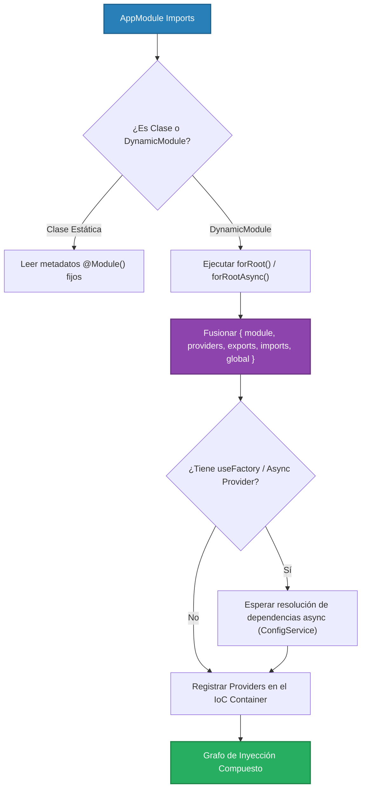

# 3.2 - Dynamic Modules (`forRoot`, `register`, `forRootAsync`)

> **Objetivo del módulo:** Construir módulos parametrizables y reutilizables capaces de alterar su grafo de dependencias en tiempo de ejecución, dominando las convenciones de la comunidad NestJS (`register`, `forRoot`, `forFeature`) y el patrón asíncrono (`forRootAsync`) para resolver configuraciones dinámicas desde el IoC Container (`ConfigService`).

---

## 🧭 1. Posición en la Arquitectura IoC & Bootstrap Engine

Los Módulos Dinámicos operan en la fase más temprana del arranque de NestJS (`DependenciesScanner`), antes de la instanciación de cualquier controller o service:



- **Frontera de ejecución**: Exclusivamente durante el bootstrap (`NestFactory.create()`). Retornan un objeto que implementa la interfaz `DynamicModule` de `@nestjs/common`.
- **Under the Hood**: Un `DynamicModule` no reemplaza al decorador `@Module()`, sino que **extiende dinámicamente sus metadatos**. Lo que retorna la función estática (`providers`, `exports`, etc.) se fusiona con los metadatos declarados en el decorador.

---

## 📜 2. El Contrato Esencial & Blueprint Idiomático

### Convenciones de Nombres de NestJS

| Método                               | Convención Semántica de Uso                                                                             | Ejemplo Estándar                                               |
| :----------------------------------- | :------------------------------------------------------------------------------------------------------ | :------------------------------------------------------------- |
| **`register()` / `registerAsync()`** | Configura un módulo para un uso local y específico del módulo importador.                               | `JwtModule.register({ secret: '...' })`                        |
| **`forRoot()` / `forRootAsync()`**   | Configura un módulo una sola vez a nivel raíz (usualmente en `AppModule`), compartido en toda la app.   | `TypeOrmModule.forRootAsync(...)`, `ConfigModule.forRoot(...)` |
| **`forFeature()`**                   | Extiende una configuración ya inicializada por `forRoot` con recursos específicos de un feature module. | `TypeOrmModule.forFeature([TaskEntity])`                       |

### Mapeo mental rápido (C# / Angular)

- **C#**: Extension methods sobre `IServiceCollection`: `services.AddHttpClient("Stripe", client => { ... })` o `services.AddAuthentication(opts => ...)`.
- **Angular**: `RouterModule.forRoot(routes)` vs `RouterModule.forChild(featureRoutes)`.

---

### Blueprint Canónico (Dominio Externo: Cliente de Correo `MailerModule`)

> 💡 _Snippet atómico que modela la estructura dual estática + asíncrona de un Dynamic Module de producción._

```typescript
// 1. Opciones y Token (src/infrastructure/mailer/mailer.interface.ts)
export const MAILER_OPTIONS_TOKEN = Symbol('MAILER_OPTIONS_TOKEN');

export interface IMailerOptions {
  host: string;
  port: number;
  isGlobal?: boolean;
}

export interface IMailerAsyncOptions {
  isGlobal?: boolean;
  imports?: any[];
  useFactory: (...args: any[]) => Promise<IMailerOptions> | IMailerOptions;
  inject?: any[];
}

// 2. Definición del Dynamic Module (src/infrastructure/mailer/mailer.module.ts)
@Module({})
export class MailerModule {
  static forRoot(options: IMailerOptions): DynamicModule {
    return {
      module: MailerModule,
      global: options.isGlobal ?? false,
      providers: [{ provide: MAILER_OPTIONS_TOKEN, useValue: options }, MailerService],
      exports: [MailerService],
    };
  }

  static forRootAsync(options: IMailerAsyncOptions): DynamicModule {
    return {
      module: MailerModule,
      global: options.isGlobal ?? false,
      imports: options.imports ?? [],
      providers: [
        {
          provide: MAILER_OPTIONS_TOKEN,
          useFactory: options.useFactory,
          inject: options.inject ?? [],
        },
        MailerService,
      ],
      exports: [MailerService],
    };
  }
}
```

---

## 💼 3. Casos de Uso del Mundo Real & Matriz de Decisión

| Escenario de Producción                                              | ¿Por qué usar Dynamic Module?                                                                   | ¿Por qué NO Static Module?                                                                                        |
| :------------------------------------------------------------------- | :---------------------------------------------------------------------------------------------- | :---------------------------------------------------------------------------------------------------------------- |
| **Integraciones con SDKs de terceros** (Redis, Twilio, SendGrid, S3) | Requieren llaves de API y URLs cargadas desde `.env` que varían por entorno.                    | Un módulo estático requeriría hardcodear valores o forzar a cada servicio a inyectar `ConfigService` manualmente. |
| **Paquetes / Librerías compartidas (Monorepo)**                      | El módulo debe ser agnóstico a la aplicación consumidora y parametrizable por quien lo importa. | Un módulo estático acopla la librería a una estructura de configuración específica.                               |
| **Feature Modules con configuración por entidad**                    | Módulos que registran repositorios dinámicos (`forFeature([User, Task])`).                      | Forzaría a declarar un módulo separado por cada tabla/entidad.                                                    |

---

## ⚠️ 4. Top Trampas Mortales & Antipatrones

| Antipatrón / Trampa Común                                       | Causa Técnica / Under the Hood                                                                                                                                                       | Corrección Idiomática                                                                                                       |
| :-------------------------------------------------------------- | :----------------------------------------------------------------------------------------------------------------------------------------------------------------------------------- | :-------------------------------------------------------------------------------------------------------------------------- |
| **Olvidar `module: MyModule` en el retorno de `DynamicModule`** | NestJS necesita la propiedad `module` para asociar los providers a la clase del módulo en el `ModulesContainer`. Sin ella, falla en bootstrap con error de validación de metadata.   | Incluir siempre `module: NombreDeLaClase` en el objeto retornado.                                                           |
| **Olvidar re-exportar el servicio (`exports`)**                 | Los providers creados en el método estático son privados del módulo dinámico a menos que se listen en `exports`.                                                                     | Agregar el servicio al array `exports` del `DynamicModule` retornado.                                                       |
| **No reenviar `imports` en `forRootAsync`**                     | Si `useFactory` inyecta `ConfigService` pero en el `DynamicModule` no se pasa `imports: options.imports`, NestJS no tendrá acceso al módulo dueño de la dependencia en ese contexto. | Pasar siempre `imports: options.imports ?? []` en el objeto `DynamicModule`.                                                |
| **Multi-instanciación accidental por no usar `global: true`**   | Si importas un módulo dinámico con `register()` en múltiples módulos consumidores, Nest crea singletons independientes para cada uno.                                                | Usar `global: options.isGlobal ?? false` cuando el módulo represente un cliente transversal único (ej. notificador, cache). |

---

## 🎯 5. Reto Práctico (Hands-on Challenge)

### Contexto & Objetivo de Negocio

En el tema 3.1 creamos `ConsoleTaskNotifierService` hardcodeado en `TasksModule`. Ahora debemos evolucionar la arquitectura:
Las notificaciones son una capacidad transversal del sistema (podrían usarlas `TasksModule`, `UsersModule` o futuros módulos).

Debemos encapsular esta capacidad en un **Módulo Dinámico reutilizable** (`NotificationsModule`) ubicado en `src/core/notifications/`:

1. Soportará configuración estática (`forRoot`) y asíncrona (`forRootAsync`).
2. Recibirá `appName` y `channel` (`'console' | 'silent'`).
3. Se configurará globalmente en `AppModule` mediante `.forRootAsync()` consumiendo `ConfigService`.
4. `TasksService` consumirá el nuevo `NotificationsService` provisto por el módulo dinámico.

---

### Especificación Funcional & Contratos Detallados

#### 1. Contratos y Token (`src/core/notifications/notifications.interface.ts`)

```typescript
export const NOTIFICATIONS_OPTIONS_TOKEN = Symbol('NOTIFICATIONS_OPTIONS_TOKEN');

export type NotificationChannel = 'console' | 'silent';

export interface INotificationsModuleOptions {
  appName: string;
  channel?: NotificationChannel;
  isGlobal?: boolean;
}

export interface INotificationsModuleAsyncOptions {
  isGlobal?: boolean;
  imports?: any[];
  useFactory: (
    ...args: any[]
  ) => Promise<INotificationsModuleOptions> | INotificationsModuleOptions;
  inject?: any[];
}

export interface INotificationResult {
  sentAt: string;
  channel: NotificationChannel;
  delivered: boolean;
}
```

#### 2. Servicio de Notificaciones (`src/core/notifications/notifications.service.ts`)

- Inyecta `@Inject(NOTIFICATIONS_OPTIONS_TOKEN) private readonly options: INotificationsModuleOptions`.
- Utiliza `Logger` de NestJS con contexto `NotificationsService.name`.
- Expone el método:
  ```typescript
  notify(message: string, context?: Record<string, unknown>): INotificationResult
  ```
- **Lógica**:
  - Si `channel` es `'console'` (o por defecto si es undefined):
    - Emite un log: `[${this.options.appName}] ${message} ${context ? JSON.stringify(context) : ''}`.
    - Retorna `{ sentAt: new Date().toISOString(), channel: 'console', delivered: true }`.
  - Si `channel` es `'silent'`:
    - No emite log y retorna `{ sentAt: new Date().toISOString(), channel: 'silent', delivered: false }`.

#### 3. Módulo Dinámico (`src/core/notifications/notifications.module.ts`)

- Decorado con `@Module({})`.
- Implementa los métodos estáticos:
  - `static forRoot(options: INotificationsModuleOptions): DynamicModule`
  - `static forRootAsync(options: INotificationsModuleAsyncOptions): DynamicModule`
- Ambos métodos deben:
  - Definir `module: NotificationsModule`.
  - Configurar `global: options.isGlobal ?? false`.
  - Proveer las opciones bajo el token `NOTIFICATIONS_OPTIONS_TOKEN`.
  - Registrar y exportar `NotificationsService`.
  - En `forRootAsync`, propagar `imports: options.imports ?? []`.

#### 4. Integración en `AppModule` (`src/app.module.ts`)

- Importar `NotificationsModule.forRootAsync({ ... })`:
  - `isGlobal: true`
  - `imports: [ConfigModule]` (o aprovechar que ConfigModule ya está en `imports`)
  - `useFactory: (config: ConfigService) => ({ appName: config.get<string>('APP_NAME') ?? 'TaskTracker', channel: 'console' })`
  - `inject: [ConfigService]`

#### 5. Refactor en `TasksService` (`src/modules/tasks/tasks.service.ts`) y limpieza de 3.1

- Eliminar el provider ad-hoc de `TasksModule` (`tasks.module.ts` vuelve a tener solo `providers: [TaskService]`).
- Eliminar la carpeta `src/modules/tasks/services/` y `src/modules/tasks/interfaces/task-notifier.interface.ts`.
- En `TasksService`, inyectar directamente `private readonly notificationsService: NotificationsService`.
- En `create(dto: CreateTaskDto)`:
  - Invocar `this.notificationsService.notify('Task created', { id: newTask.id, title: newTask.title, userId: newTask.userId })`.

---

### Pruebas de Verificación (cURL / HTTP)

Crear una tarea para verificar que el log estructurado se dispara a través del módulo dinámico global:

```bash
curl -X POST http://localhost:8888/api/v1/tasks \
  -H "Content-Type: application/json" \
  -H "x-api-key: nest-sandbox-secret-key" \
  -H "x-user-role: USER" \
  -d '{
    "title": "Aprender Dynamic Modules",
    "description": "Dominando forRootAsync y ConfigService",
    "userId": "fcea2b64-2dba-47d1-ac32-cdc13541efeb"
  }'
```

_Verificación esperada en terminal_:

```text
[Nest] ... [NotificationsService] [nest-sandbox-api] Task created {"id":"...","title":"Aprender Dynamic Modules","userId":"fcea2b64-..."}
```

---

### Criterios de Aceptación (Definition of Done - DoD)

- [ ] Contratos y token creados en `src/core/notifications/notifications.interface.ts`.
- [ ] `NotificationsService` implementado con soporte para canales `'console'` y `'silent'`.
- [ ] `NotificationsModule` implementa `forRoot` y `forRootAsync` exportando `NotificationsService`.
- [ ] `AppModule` inicializa `NotificationsModule.forRootAsync` con `isGlobal: true` e inyección de `ConfigService`.
- [ ] `TasksModule` simplificado (sin providers duplicados) y `TasksService` consumiendo `NotificationsService`.
- [ ] Linter y tests unitarios pasando limpiamente (`bun run lint && bun test`).

---

## 🧠 6. Checklist de Active Recall

- [ ] ¿Cuál es la diferencia de intención entre `forRoot()`, `register()` y `forFeature()`?
- [ ] ¿Por qué un Dynamic Module asíncrono necesita la propiedad `imports` en `forRootAsync` si ya recibe `useFactory` e `inject`?
- [ ] ¿Qué problema previene marcar `isGlobal: true` en un Dynamic Module como `NotificationsModule`?
