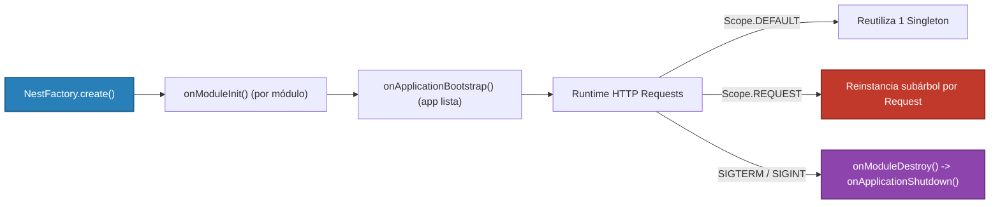

# 3.3 - Scopes de Inyección & Lifecycle Hooks

> **Objetivo del módulo:** Controlar el tiempo de vida en memoria de cada provider (`DEFAULT`, `TRANSIENT`, `REQUEST`), prevenir la degradación por _Scope Bubbling_, y orquestar inicialización y liberación limpia de recursos mediante los Lifecycle Hooks del contenedor IoC.

---

## 🧭 1. Posición en el Lifecycle & Alcance de Scopes

Los **Lifecycle Hooks** gobiernan el ciclo completo de la aplicación (arranque y apagado), mientras que los **Injection Scopes** determinan cuántas veces y cuándo se instancia el grafo de dependencias:



- **Frontera de ejecución (Lifecycle Hooks):** Solo se ejecutan automáticamente sobre providers **`Scope.DEFAULT` (Singleton)**. NestJS **no** invoca `onModuleInit` ni `onModuleDestroy` en providers `Scope.REQUEST` o `Scope.TRANSIENT`.
- **Scope Bubbling:** El scope se propaga hacia arriba en el grafo de dependencias. Si `ControllerA` (`DEFAULT`) inyecta `ServiceB` (`DEFAULT`), y este inyecta `ContextC` (`REQUEST`), **tanto `ServiceB` como `ControllerA` mutan silenciosamente a `Scope.REQUEST`**.

---

## 📜 2. El Contrato Esencial & Blueprints Idiomáticos

### Tabla de Scopes & Mapeo Mental (C# / Angular)

| NestJS Scope          | Equivalente C# (ASP.NET Core) | Equivalente Angular                          | Instanciación & Costo                                                     |
| :-------------------- | :---------------------------- | :------------------------------------------- | :------------------------------------------------------------------------ |
| **`Scope.DEFAULT`**   | `AddSingleton<T>()`           | `providedIn: 'root'`                         | 1 instancia por aplicación. Máximo rendimiento (cero GC por request).     |
| **`Scope.TRANSIENT`** | `AddTransient<T>()`           | `@Injectable()` en `providers` de componente | 1 instancia privada **por cada clase consumidora** (no por request).      |
| **`Scope.REQUEST`**   | `AddScoped<T>()`              | N/A (SSR transfer state)                     | 1 instancia por petición HTTP entrante + **Scope Bubbling** hacia arriba. |

### Secuencia de Lifecycle Hooks (Orden Estricto)

1. **Arranque:** `OnModuleInit` (hojas hacia raíz) $\rightarrow$ `OnApplicationBootstrap` (todos los módulos inicializados) $\rightarrow$ servidor empieza a escuchar tráfico.
2. **Apagado** (requiere `app.enableShutdownHooks()`): `OnModuleDestroy` $\rightarrow$ `BeforeApplicationShutdown(signal)` $\rightarrow$ cierre de conexiones HTTP $\rightarrow$ `OnApplicationShutdown(signal)`.

### Variante A: Resource Lifecycle Management (Dominio Externo: `RedisPoolService`)

```typescript
import {
  Injectable,
  Logger,
  OnApplicationBootstrap,
  OnModuleDestroy,
  OnModuleInit,
} from '@nestjs/common';

@Injectable()
export class RedisPoolService implements OnModuleInit, OnApplicationBootstrap, OnModuleDestroy {
  private readonly logger = new Logger(RedisPoolService.name);
  private connected = false;

  async onModuleInit(): Promise<void> {
    this.connected = true;
    this.logger.log('Redis connection pool opened');
  }

  onApplicationBootstrap(): void {
    this.logger.log(`Redis ready (connected=${this.connected})`);
  }

  async onModuleDestroy(): Promise<void> {
    this.connected = false;
    this.logger.log('Redis connection pool drained and closed');
  }
}
```

### Variante B: Request-Scoped Provider (Dominio Externo: `TenantContextService`)

```typescript
import { Inject, Injectable, Scope } from '@nestjs/common';
import { REQUEST } from '@nestjs/core';
import type { Request } from 'express';

@Injectable({ scope: Scope.REQUEST })
export class TenantContextService {
  readonly createdAt = Date.now();

  constructor(@Inject(REQUEST) private readonly request: Request) {}

  getTenantId(): string {
    const header = this.request.headers['x-tenant-id'];
    return Array.isArray(header) ? header[0] : (header ?? 'default');
  }
}
```

---

## 💼 3. Casos de Uso del Mundo Real & Matriz de Decisión

| Escenario de Producción                                              | Elección Correcta                                           | ¿Por qué NO otra alternativa?                                                                                                     |
| :------------------------------------------------------------------- | :---------------------------------------------------------- | :-------------------------------------------------------------------------------------------------------------------------------- |
| **Pool de BD, colas, clientes HTTP/SDK**                             | `Scope.DEFAULT` + `OnModuleInit` / `OnModuleDestroy`        | Abrir sockets por request agota descriptores de archivo y destruye la latencia.                                                   |
| **Trazabilidad o estado aislado por petición**                       | `AsyncLocalStorage` (Node nativo) o `@CurrentUser()`        | `Scope.REQUEST` reinstancia todo el subárbol de servicios y controllers en cada request, disparando asignaciones de memoria y GC. |
| **Multitenancy estricto donde una librería exige DI por request**    | `Scope.REQUEST` aislado en un módulo hoja o `durable: true` | `Scope.TRANSIENT` no comparte estado entre dos servicios dentro de la misma petición.                                             |
| **Generador de estado efímero por consumidor (p. ej. logger local)** | `Scope.TRANSIENT`                                           | Permite que cada clase receptora tenga su propia instancia aislada sin propagar `Scope.REQUEST` al controller.                    |

---

## ⚠️ 4. Top Trampas Mortales & Antipatrones

| Antipatrón / Trampa Común                                                                 | Causa Técnica / Under the Hood                                                                                                                          | Corrección Idiomática                                                                                                               |
| :---------------------------------------------------------------------------------------- | :------------------------------------------------------------------------------------------------------------------------------------------------------ | :---------------------------------------------------------------------------------------------------------------------------------- |
| **Olvidar `app.enableShutdownHooks()` en `main.ts`**                                      | Por rendimiento en tests, NestJS desactiva los listeners de `SIGTERM`/`SIGINT` por defecto; `onModuleDestroy()` nunca se ejecuta al detener el proceso. | Llamar `app.enableShutdownHooks()` en `bootstrap()` antes de `app.listen()`.                                                        |
| **Poner `Scope.REQUEST` en un servicio usado por servicios con estado en memoria**        | Por _Scope Bubbling_, el servicio padre y el controller también pasan a `Scope.REQUEST`, reiniciando arrays/cachés en memoria en cada petición.         | Mantener servicios con estado en `Scope.DEFAULT` y pasar datos de request como argumentos de método o mediante `AsyncLocalStorage`. |
| **Implementar `OnModuleDestroy` en un provider `Scope.REQUEST`**                          | El contenedor IoC solo rastrea y destruye singletons al apagar la app; los providers por request se descartan para GC al terminar el response.          | Mover la gestión de conexiones y cleanup a providers `Scope.DEFAULT`.                                                               |
| **Inyectar `REQUEST` en un Guard o Middleware esperando que funcione como Request Scope** | Los Middlewares son singletons fuera del árbol de scopes de handlers; `REQUEST` no aplica en `NestMiddleware`.                                          | Leer directamente `req` en `use(req, res, next)` o usar `ExecutionContext` en Guards/Interceptors.                                  |

---

## 🎯 5. Reto Práctico (Hands-on Challenge)

### Contexto & Objetivo de Negocio

Necesitamos agregar observabilidad y auditoría de tareas en nuestra **Task & Project Management API** sin contaminar el estado singleton de `TaskService` (`SEED` en memoria):

1. Un **sink de auditoría singleton** (`AuditSinkService`) que simule una conexión externa con apertura, verificación post-bootstrap y vaciado ordenado al apagar el servidor (`SIGTERM`/`SIGINT`).
2. Un **diagnóstico de scopes** (`AuditController`) que evidencie en tiempo real la diferencia entre `Scope.DEFAULT`, `Scope.REQUEST` (con _Scope Bubbling_ e inyección de `REQUEST`) y `Scope.TRANSIENT`, manteniendo `TaskService` y `TasksController` intactos como singletons.

---

### Especificación por Archivo

#### 1. Contratos (`src/core/audit/audit.interface.ts`)

```typescript
export interface IAuditEntry {
  id: string;
  action: string;
  taskId: string;
  actorId: string;
  createdAt: string;
}

export interface IAuditSinkStatus {
  instanceId: string;
  connected: boolean;
  bufferedCount: number;
}

export interface IAuditDiagnosticResponse {
  sink: IAuditSinkStatus;
  traceInstanceId: string;
  controllerInstanceId: string;
  requestId: string;
  actorId: string;
  probeIds: {
    first: string;
    second: string;
  };
}
```

#### 2. Singleton con Lifecycle Hooks (`src/core/audit/audit-sink.service.ts`)

- Decorado con `@Injectable()` (`Scope.DEFAULT` implícito).
- Implementa `OnModuleInit`, `OnApplicationBootstrap`, `OnModuleDestroy`.
- Propiedades privadas/readonly:
  - `readonly instanceId: string = crypto.randomUUID().slice(0, 8)`
  - `private connected = false`
  - `private readonly entries: IAuditEntry[] = []`
  - `private readonly logger = new Logger(AuditSinkService.name)`
- Lifecycle hooks:
  - `onModuleInit(): void` $\rightarrow$ establece `this.connected = true` y loggea `[AuditSink:${this.instanceId}] Connection opened (OnModuleInit)`.
  - `onApplicationBootstrap(): void` $\rightarrow$ loggea `[AuditSink:${this.instanceId}] Ready to accept audit entries (OnApplicationBootstrap)`.
  - `onModuleDestroy(): void` $\rightarrow$ loggea `[AuditSink:${this.instanceId}] Flushing ${this.entries.length} entries & closing connection (OnModuleDestroy)`, vacía `this.entries.length = 0` y pone `this.connected = false`.
- Métodos públicos:
  - `record(entry: Omit<IAuditEntry, 'id' | 'createdAt'>): IAuditEntry`:
    - Si `!this.connected`, lanza `new ServiceUnavailableException('Audit sink is not connected')`.
    - Construye `{ id: crypto.randomUUID(), createdAt: new Date().toISOString(), ...entry }`, lo agrega a `this.entries` y lo retorna.
  - `getStatus(): IAuditSinkStatus`: retorna `{ instanceId: this.instanceId, connected: this.connected, bufferedCount: this.entries.length }`.

#### 3. Provider `Scope.REQUEST` (`src/core/audit/request-trace.service.ts`)

- Decorado con `@Injectable({ scope: Scope.REQUEST })`.
- Propiedad `readonly instanceId: string = crypto.randomUUID().slice(0, 8)`.
- Inyecta `@Inject(REQUEST) private readonly request: IAuthenticatedRequest`.
- Métodos:
  - `getRequestId(): string`: lee `this.request.headers['x-request-id']` (si es `string[]`, devuelve `header[0]`; si no existe, `'unknown'`).
  - `getActorId(): string`: devuelve `this.request.user?.id ?? 'anonymous'`.

#### 4. Provider `Scope.TRANSIENT` (`src/core/audit/diagnostic-probe.service.ts`)

- Decorado con `@Injectable({ scope: Scope.TRANSIENT })`.
- Propiedad `readonly instanceId: string = crypto.randomUUID().slice(0, 8)`.

#### 5. Controlador de Diagnóstico (`src/core/audit/audit.controller.ts`)

- `@Controller('audit')` y `@UseGuards(ApiKeyGuard)` (para hidratar `request.user` antes de responder).
- Propiedad `private readonly controllerInstanceId: string = crypto.randomUUID().slice(0, 8)`.
- Constructor inyecta:
  - `private readonly auditSink: AuditSinkService`
  - `private readonly requestTrace: RequestTraceService`
  - `private readonly firstProbe: DiagnosticProbeService`
  - `private readonly secondProbe: DiagnosticProbeService`
- `@Get('diagnostics') getDiagnostics(): IAuditDiagnosticResponse`:
  - Retorna el objeto `IAuditDiagnosticResponse` con los IDs y estado actuales.

#### 6. Módulo e Integración (`audit.module.ts`, `app.module.ts`, `tasks.module.ts`, `tasks.service.ts`, `main.ts`)

- `src/core/audit/audit.module.ts`: declara `controllers: [AuditController]`, `providers: [AuditSinkService, RequestTraceService, DiagnosticProbeService]`, `exports: [AuditSinkService]` (**no** usar `@Global()`).
- `src/app.module.ts`: importa `AuditModule`.
- `src/modules/tasks/tasks.module.ts`: importa `AuditModule`.
- `src/modules/tasks/tasks.service.ts`: inyecta `private readonly auditSink: AuditSinkService` (Singleton) y en `create(dto)` registra el evento con `this.auditSink.record({ action: 'TASK_CREATED', taskId: newTask.id, actorId: newTask.userId })`. (**No** inyectes `RequestTraceService` aquí; observa cómo `TaskService` permanece `Scope.DEFAULT` y no pierde su arreglo `tasks` entre peticiones).
- `src/main.ts`: habilita `app.enableShutdownHooks()` antes de `await app.listen(port)`.

---

### Matriz de Verificación (cURL & Shutdown)

1. **Verificar Scopes & Bubbling (ejecutar 2 veces seguidas):**

```bash
curl -s http://localhost:8888/api/v1/audit/diagnostics \
  -H "x-api-key: nest-sandbox-secret-key" \
  -H "x-user-id: fcea2b64-2dba-47d1-ac32-cdc13541efeb"
```

_Resultado esperado entre la petición 1 y la 2:_

- `sink.instanceId`: **Idéntico** (`Scope.DEFAULT`).
- `traceInstanceId`: **Diferente** en cada petición (`Scope.REQUEST`).
- `controllerInstanceId`: **Diferente** en cada petición (prueba empírica de _Scope Bubbling_ en `AuditController`).
- `probeIds.first === probeIds.second` dentro de `AuditController`: **Idénticos** porque en NestJS `Scope.TRANSIENT` cachea por `(inquirerId, contextId)` — una instancia privada por **clase consumidora**, no por parámetro de constructor (para ver IDs distintos debe inyectarse en dos clases diferentes, p. ej. `AuditController` y `RequestTraceService`).

2. **Verificar persistencia Singleton en `TaskService` + `AuditSinkService`:**

```bash
curl -s -X POST http://localhost:8888/api/v1/tasks \
  -H "Content-Type: application/json" \
  -H "x-api-key: nest-sandbox-secret-key" \
  -H "x-user-role: USER" \
  -d '{
    "title": "Verificar Lifecycle",
    "description": "AuditSink singleton + shutdown hook",
    "userId": "fcea2b64-2dba-47d1-ac32-cdc13541efeb"
  }'
```

_Luego vuelve a consultar `GET /api/v1/audit/diagnostics`_: `sink.bufferedCount` debe haber subido a `1` y `GET /api/v1/tasks` debe seguir conservando las tareas anteriores.

3. **Verificar Shutdown Hooks:** Detener el servidor con `Ctrl+C` (`SIGINT`) y confirmar en consola el log:
   `[AuditSinkService] [AuditSink:...] Flushing 1 entries & closing connection (OnModuleDestroy)`.

---

### Criterios de Aceptación (Definition of Done - DoD)

- [ ] Contratos creados en `src/core/audit/audit.interface.ts`.
- [ ] `AuditSinkService` implementa `OnModuleInit`, `OnApplicationBootstrap` y `OnModuleDestroy`.
- [ ] `RequestTraceService` (`Scope.REQUEST`) y `DiagnosticProbeService` (`Scope.TRANSIENT`) implementados sin `any`.
- [ ] `AuditController` expone `GET /api/v1/audit/diagnostics` demostrando `DEFAULT`, `REQUEST` (bubbling) y `TRANSIENT`.
- [ ] `TaskService` consume `AuditSinkService` manteniendo `Scope.DEFAULT`.
- [ ] `app.enableShutdownHooks()` configurado en `src/main.ts` y verificado al apagar.
- [ ] Type-check, linter y tests pasando (`tsc --noEmit`, `eslint`, `jest`).

---

## 🧠 6. Checklist de Active Recall

- [ ] ¿Por qué `AuditController` genera un nuevo `controllerInstanceId` en cada petición aunque no tenga `@Controller({ scope: Scope.REQUEST })`?
- [ ] ¿Qué ocurre con `onModuleDestroy()` si no llamas a `app.enableShutdownHooks()` en `main.ts`?
- [ ] ¿Por qué NestJS prohíbe o ignora los Lifecycle Hooks en providers con `Scope.REQUEST`?
