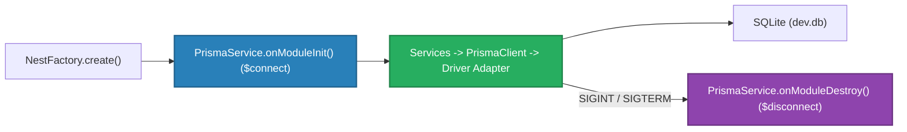

# 4.1 - Base de Datos & ORM (Prisma 7 + SQLite)

> **Objetivo del módulo:** Integrar persistencia relacional real en NestJS mediante Prisma 7 (Driver Adapters sin motor Rust), gestionando esquema declarativo, migraciones versionadas, conexión eagerly-checked con Lifecycle Hooks y configuración fail-fast.

---

## 🧭 1. Posición en el Lifecycle & Arquitectura de Persistencia

`PrismaService` opera como un **Singleton de infraestructura (`Scope.DEFAULT`)** enlazado al arranque y apagado del contenedor IoC, traduciendo consultas tipadas de TypeScript a SQL mediante el Driver Adapter (`better-sqlite3`):



- **Frontera de conexión (Eager vs Lazy):** Prisma conecta de forma perezosa (_lazy_) en la primera query si no llamas `$connect()`. Invocar `await this.$connect()` en `onModuleInit()` convierte fallos de credenciales/archivo en errores **fail-fast** al arrancar.
- **Pooling & Concurrencia:** En bases de datos servidor (PostgreSQL/MySQL), `PrismaClient` gestiona un _connection pool_ reutilizable dentro del singleton; abrir múltiples `new PrismaClient()` por módulo o request agota las conexiones del servidor. En SQLite (archivo local con driver `better-sqlite3`), el singleton serializa escrituras sobre un único handle.

---

## 📜 2. El Contrato Esencial & Blueprint Idiomático

### Mapeo Mental (C# / Entity Framework Core)

| Concepto Prisma 7                    | Equivalente EF Core (C#)                       | Rol Técnico                                                                   |
| :----------------------------------- | :--------------------------------------------- | :---------------------------------------------------------------------------- |
| `schema.prisma`                      | `DbContext` + Fluent API / Models              | Fuente única de verdad del modelo relacional y enums.                         |
| `prisma migrate dev`                 | `dotnet ef migrations add` + `database update` | Genera SQL incremental versionado en `prisma/migrations/`.                    |
| `prisma.config.ts`                   | `IDesignTimeDbContextFactory`                  | Resuelve `DATABASE_URL` y rutas para comandos del CLI en tiempo de diseño.    |
| `PrismaService extends PrismaClient` | `DbContext` registrado como Singleton/Pool     | Proveedor injectable en NestJS que administra `$connect()` / `$disconnect()`. |

### Blueprint Canónico (Dominio Externo: `InventoryPrismaService`)

```typescript
// prisma.config.ts (raíz del proyecto — solo CLI)
import 'dotenv/config';
import { defineConfig, env } from 'prisma/config';

export default defineConfig({
  schema: 'prisma/schema.prisma',
  migrations: { path: 'prisma/migrations' },
  datasource: { url: env('DATABASE_URL') },
});
```

```typescript
// src/core/database/prisma.service.ts (Runtime NestJS — CJS compatible)
import { Injectable, Logger, OnModuleDestroy, OnModuleInit } from '@nestjs/common';
import { ConfigService } from '@nestjs/config';
import { PrismaBetterSqlite3 } from '@prisma/adapter-better-sqlite3';
import { PrismaClient } from '@/generated/prisma/client';

@Injectable()
export class PrismaService extends PrismaClient implements OnModuleInit, OnModuleDestroy {
  private readonly logger = new Logger(PrismaService.name);

  constructor(configService: ConfigService) {
    const adapter = new PrismaBetterSqlite3({
      url: configService.getOrThrow<string>('DATABASE_URL'),
    });
    super({ adapter });
  }

  async onModuleInit(): Promise<void> {
    await this.$connect();
    this.logger.log('Database connection established');
  }

  async onModuleDestroy(): Promise<void> {
    await this.$disconnect();
    this.logger.log('Database connection closed');
  }
}
```

---

## 💼 3. Casos de Uso del Mundo Real & Matriz de Decisión

| Escenario                                          | Prisma 7                                                                                                           | TypeORM                                                                                        |
| :------------------------------------------------- | :----------------------------------------------------------------------------------------------------------------- | :--------------------------------------------------------------------------------------------- |
| **Seguridad de tipos estricta (TypeScript-first)** | Tipos generados exactos por consulta (`select`, `include`), cero decoradores en entidades.                         | Entidades acopladas a decoradores de runtime; `relations` propensas a `undefined` en runtime.  |
| **Migraciones seguras en equipo**                  | `migrate dev` detecta _schema drift_ y genera SQL determinista revisable en PRs.                                   | `synchronize: true` es peligroso en prod; `migration:generate` a veces produce diffs ruidosos. |
| **Aislamiento de dominio (Clean / Hexagonal)**     | El esquema vive fuera de los módulos de dominio (`prisma/schema.prisma`), facilitando el Repository Pattern (4.2). | Fomenta acoplar clases de dominio con `@Entity()`, `@Column()`.                                |

---

## ⚠️ 4. Top Trampas Mortales & Antipatrones

| Antipatrón / Trampa Común                                                | Causa Técnica / Under the Hood                                                                                                    | Corrección Idiomática                                                                                                                              |
| :----------------------------------------------------------------------- | :-------------------------------------------------------------------------------------------------------------------------------- | :------------------------------------------------------------------------------------------------------------------------------------------------- |
| **Olvidar `moduleFormat = "cjs"` en Prisma 7 con `tsconfig` `nodenext`** | NestJS compila a CommonJS, pero Prisma 7 infiere ESM desde `nodenext`, generando imports `.js`/ESM que rompen en runtime.         | Declarar `moduleFormat = "cjs"` dentro de `generator client` en `schema.prisma`.                                                                   |
| **Instanciar `new PrismaClient()` en varios servicios o módulos**        | Cada instancia abre su propio pool/conexión y escapa del ciclo de vida de NestJS, fugando conexiones al apagar.                   | Exportar un único `PrismaService` singleton desde `PrismaModule`.                                                                                  |
| **Dejar `url = env("DATABASE_URL")` en `schema.prisma` (Prisma 7)**      | Prisma 7 eliminó la URL del datasource en `schema.prisma` y lanza error `P1012` en `generate`/`migrate`.                          | Mover `datasource.url` exclusivamente a `prisma.config.ts`.                                                                                        |
| **No traducir errores conocidos de Prisma (`P2025`, `P2002`, `P2003`)**  | Prisma lanza `PrismaClientKnownRequestError` (no `HttpException`), que el filtro global convierte en `500 Internal Server Error`. | Verificar existencia (`findUnique` $\rightarrow$ `NotFoundException`) o mapear códigos (`P2025` $\rightarrow$ `404`, `P2002` $\rightarrow$ `409`). |

---

## 🎯 5. Reto Práctico (Hands-on Challenge)

### Contexto & Objetivo de Negocio

Reemplazaremos los arreglos `SEED` en memoria de `UsersService` y `TaskService` por persistencia real en **SQLite** usando **Prisma 7**, conservando intactos los contratos HTTP existentes de `TasksController` (`/api/v1/tasks`) y el seeding inicial para que la colección en [tasks.http](file:///Users/1147839/Documents/dev/courses/nest/nest-first-app/client/tasks.http) siga funcionando tras reiniciar el servidor.

---

### Especificación Paso a Paso

#### 1. Dependencias y Configuración de Tooling

- Instalar dependencias (requiere `prisma`, `@prisma/client`, `@prisma/adapter-better-sqlite3`, `better-sqlite3`, `dotenv`, y `@types/better-sqlite3` como devDependency).
- **`.env` y `.env.example`**: Agregar `DATABASE_URL="file:./dev.db"`.
- **`src/core/env.schema.ts`**: Agregar `DATABASE_URL: z.string().min(1)` para mantener validación fail-fast.
- **`.gitignore`**: Agregar `*.db`, `*.db-journal` y `/src/generated`.
- **`eslint.config.mjs`**: Agregar `'src/generated/**'` a `ignores` para que ESLint no audite código autogenerado por Prisma.

#### 2. Esquema Prisma y Config (`prisma/schema.prisma` & `prisma.config.ts`)

- **`prisma.config.ts`** (raíz): Configurar `schema: 'prisma/schema.prisma'`, `migrations: { path: 'prisma/migrations' }`, `datasource: { url: env('DATABASE_URL') }`.
- **`prisma/schema.prisma`**:
  - `generator client`: `provider = "prisma-client"`, `output = "../src/generated/prisma"`, `moduleFormat = "cjs"`.
  - `datasource db`: `provider = "sqlite"` (sin `url`).
  - Modelos mínimos alineados con `IUserEntity` e `ITaskEntity`:
    - `enum UserRole { ADMIN USER VIEWER }`
    - `model User`: `id String @id @default(uuid())`, `name String`, `email String @unique`, `role UserRole @default(USER)`, `tasks Task[]`, `createdAt DateTime @default(now())`, `updatedAt DateTime @updatedAt`.
    - `model Task`: `id String @id @default(uuid())`, `title String`, `description String`, `completed Boolean @default(false)`, `userId String`, `user User @relation(fields: [userId], references: [id], onDelete: Cascade)`, `createdAt DateTime @default(now())`, `updatedAt DateTime @updatedAt`.
- Ejecutar migración inicial (`bunx prisma migrate dev --name init`) y generación (`bunx prisma generate`).

#### 3. Seed Idempotente (`prisma/seed.ts`)

- Crear un script ejecutable (vía `bunx ts-node` o `bun`) que use `upsert` para asegurar al menos:
  - El usuario `fcea2b64-2dba-47d1-ac32-cdc13541efeb` (`name: 'Dev User'`, `email: 'dev@sandbox.com'`, `role: 'USER'`).
  - 2–3 tareas semilla iniciales (opcional con `upsert` por UUID fijo para idempotencia).
- Agregar script `"db:seed"` en `package.json` y ejecutarlo para poblar `dev.db`.

#### 4. Módulo de Base de Datos (`src/core/database/`)

- **`src/core/database/prisma.service.ts`**:
  - Extiende `PrismaClient` (importado desde `@/generated/prisma/client`) e implementa `OnModuleInit` y `OnModuleDestroy`.
  - Inyecta `ConfigService<IEnvSchema, true>` y construye `new PrismaBetterSqlite3({ url: configService.getOrThrow('DATABASE_URL', { infer: true }) })` para pasarlo a `super({ adapter })`.
  - `onModuleInit()`: `await this.$connect()` + log contextual.
  - `onModuleDestroy()`: `await this.$disconnect()` + log contextual.
- **`src/core/database/prisma.module.ts`**:
  - Declara y exporta `PrismaService` (si decides no hacerlo `@Global()`, impórtalo explícitamente en `UsersModule` y `TasksModule`; si usas `@Global()`, justifícalo en `AppModule` como infraestructura raíz según `USER.md` 1.4).

#### 5. Persistencia en `UsersService` y `TaskService`

- **`src/modules/users/users.service.ts`**:
  - Inyectar `PrismaService`, eliminar `SEED` en memoria.
  - `findAll(): Promise<IUserEntity[]>` y `findOne(id: string): Promise<IUserEntity>` (mapear `role` de Prisma enum al enum `EUserRole` o asegurar compatibilidad de tipos sin `any` ni casts inseguros; lanzar `NotFoundException` si `findUnique` retorna `null`).
- **`src/modules/tasks/tasks.service.ts` y `tasks.controller.ts`**:
  - Inyectar `PrismaService`, eliminar `SEED` en memoria.
  - Convertir métodos a `async` retornando `Promise<ITaskEntity[]>` / `Promise<ITaskEntity>` / `Promise<void>`:
    - `findAll()`: `this.prisma.task.findMany()`.
    - `findOne(id)`: `this.prisma.task.findUnique({ where: { id } })` $\rightarrow$ si es `null`, `throw new NotFoundException(...)`.
    - `create(dto)`: `await this.usersService.findOne(dto.userId)` (garantiza 404 limpio antes de violar FK `P2003`), luego `this.prisma.task.create({ data: { ... } })`, notificar y auditar.
    - `replace(id, dto)`: verificar existencia con `await this.findOne(id)` y `await this.usersService.findOne(dto.userId)`, luego `this.prisma.task.update({ where: { id }, data: { ... } })`.
    - `patch(id, dto)`: verificar existencia con `await this.findOne(id)` (y `usersService.findOne(dto.userId)` si viene `dto.userId`), luego `this.prisma.task.update(...)`.
    - `remove(id)`: verificar existencia con `await this.findOne(id)`, luego `await this.prisma.task.delete({ where: { id } })`.
  - Actualizar las firmas `async` en `TasksController` para retornar las promesas tipadas.

---

### Matriz de Verificación (cURL & Persistencia entre Reinicios)

1. Verificar migración y tablas en `dev.db`: `bunx prisma migrate status` debe reportar base de datos al día.
2. `POST /api/v1/tasks` con `userId: "fcea2b64-2dba-47d1-ac32-cdc13541efeb"` $\rightarrow$ `201 Created` con UUID generado por SQLite/Prisma.
3. **Reiniciar el servidor (`Ctrl+C` y `bun run start:dev`)** y ejecutar `GET /api/v1/tasks` $\rightarrow$ la tarea creada debe seguir existiendo en la respuesta.
4. `POST /api/v1/tasks` con un `userId` UUID inexistente $\rightarrow$ `404 Not Found` (no `500` de FK).
5. `GET /api/v1/tasks/<uuid-inexistente>` $\rightarrow$ `404 Not Found`.

---

### Criterios de Aceptación (Definition of Done - DoD)

- [ ] `DATABASE_URL` validado en [env.schema.ts](file:///Users/1147839/Documents/dev/courses/nest/nest-first-app/src/core/env.schema.ts) y documentado en `.env.example`.
- [ ] `prisma.config.ts` y `prisma/schema.prisma` configurados con migración `init` aplicada en `prisma/migrations/`.
- [ ] `PrismaService` implementa `OnModuleInit` (`$connect`) y `OnModuleDestroy` (`$disconnect`) vía `PrismaBetterSqlite3` sin leer `process.env` directo.
- [ ] `UsersService` y `TaskService` persisten en SQLite (sin arrays `SEED` en memoria) y sobreviven a reinicios del servidor.
- [ ] Type-check, linter y tests pasando (`tsc --noEmit`, `eslint`, `jest`).

---

## 🧠 6. Checklist de Active Recall

- [ ] ¿Por qué llamamos explícitamente a `await this.$connect()` dentro de `onModuleInit()` si Prisma conecta de forma lazy en la primera query?
- [ ] ¿Qué ventaja tiene `prisma migrate dev` frente a sincronizar tablas automáticamente al arrancar la app?
- [ ] ¿Por qué en Prisma 7 con NestJS (`nodenext`) debemos especificar `moduleFormat = "cjs"` y configurar `prisma.config.ts`?
