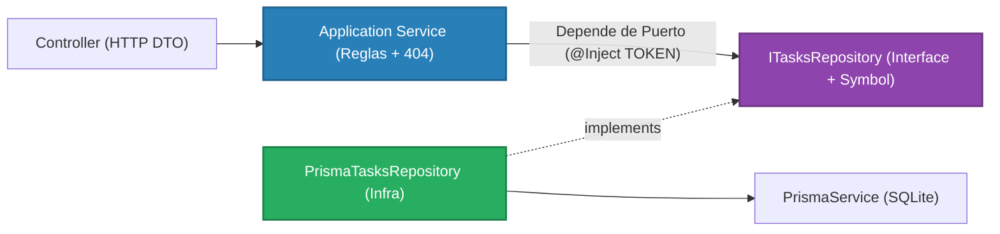

# 4.2 - Repository Pattern & Aislamiento de Entidades

> **Objetivo del módulo:** Desacoplar los servicios de aplicación (`TaskService`, `UsersService`) de Prisma mediante puertos (`interfaces` + `Symbol` tokens) y adaptadores concretos (`Prisma*Repository`), aplicando _Dependency Inversion Principle_ (DIP) sin filtrar modelos de BD ni excepciones HTTP dentro del repositorio.

---

## 🧭 1. Posición en la Arquitectura & Flujo de Dependencias (DIP)

En lugar de que la lógica de aplicación dependa directamente de `PrismaService` (infraestructura), ambos dependen de una **abstracción (Puerto)** propiedad del módulo de dominio:



- **Frontera de responsabilidad:**
  - **Application Service:** Orquesta casos de uso, normaliza inputs de negocio (`description ?? ''`), coordina servicios hermanos/notificaciones y traduce ausencias (`null`) en excepciones HTTP (`NotFoundException`).
  - **Repository Port (`interface` + `Symbol`):** Define únicamente contratos en términos del dominio (`ITaskEntity`), **zero** imports de Prisma ni DTOs HTTP.
  - **Repository Adapter (`Prisma*Repository`):** Traduce inputs del puerto a queries de Prisma y proyecta filas de Prisma (`PrismaTask`) hacia entidades de dominio (`toEntity()`).

---

## 📜 2. El Contrato Esencial & Blueprint Idiomático

### Mapeo Mental (C# / ASP.NET Core)

| Concepto NestJS + TS                                 | Equivalente C# / .NET                     | Por qué cambia en TS                                                                                           |
| :--------------------------------------------------- | :---------------------------------------- | :------------------------------------------------------------------------------------------------------------- |
| `TASKS_REPOSITORY_TOKEN = Symbol(...)` + `interface` | `ITaskRepository` directo en DI           | En TS las interfaces desaparecen en runtime (_Type Erasure_); necesitas un `Symbol` físico + `@Inject(TOKEN)`. |
| `{ provide: TOKEN, useClass: PrismaRepo }`           | `services.AddScoped<IRepo, EfCoreRepo>()` | Conecta el puerto abstracto con el adaptador concreto dentro del IoC del módulo.                               |
| `findById(id): Promise<IEntity \| null>`             | `Task<Entity?> GetByIdAsync(Guid id)`     | El repositorio retorna `null` si no existe; no acopla persistencia a `404` HTTP.                               |

### Blueprint Canónico (Dominio Externo: `Orders`)

```typescript
// 1. Puerto + Token (orders-repository.interface.ts) — Zero Prisma, Zero Nest HTTP
export const ORDERS_REPOSITORY_TOKEN = Symbol('ORDERS_REPOSITORY_TOKEN');

export type ICreateOrderData = Omit<IOrderEntity, 'id' | 'status'>;

export interface IOrdersRepository {
  findById(id: string): Promise<IOrderEntity | null>;
  create(data: ICreateOrderData): Promise<IOrderEntity>;
}

// 2. Adaptador Prisma (prisma-orders.repository.ts) — Traduce Prisma <-> Dominio
@Injectable()
export class PrismaOrdersRepository implements IOrdersRepository {
  constructor(private readonly prisma: PrismaService) {}

  private toEntity(row: PrismaOrder): IOrderEntity {
    return { id: row.id, total: row.total, status: row.status };
  }

  async findById(id: string): Promise<IOrderEntity | null> {
    const row = await this.prisma.order.findUnique({ where: { id } });
    return row ? this.toEntity(row) : null;
  }

  async create(data: ICreateOrderData): Promise<IOrderEntity> {
    return this.toEntity(await this.prisma.order.create({ data }));
  }
}

// 3. Servicio desacoplado (orders.service.ts) + Binding en orders.module.ts
// providers: [{ provide: ORDERS_REPOSITORY_TOKEN, useClass: PrismaOrdersRepository }, OrdersService]
@Injectable()
export class OrdersService {
  constructor(
    @Inject(ORDERS_REPOSITORY_TOKEN)
    private readonly ordersRepo: IOrdersRepository,
  ) {}
}
```

---

## 💼 3. Casos de Uso del Mundo Real & Matriz de Decisión

| Escenario                                                                       | Usar Repository Pattern (`Port` + `Adapter`)                               | Inyectar `PrismaService` directo en Service                                            |
| :------------------------------------------------------------------------------ | :------------------------------------------------------------------------- | :------------------------------------------------------------------------------------- |
| **Tests unitarios rápidos sin BD real**                                         | Inyectas un fake en memoria que implementa `ITasksRepository` en 5 líneas. | Obliga a mockear el árbol profundo de `prisma.task.findUnique.mockResolvedValue(...)`. |
| **Cambiar ORM o fuente de datos (Prisma $\rightarrow$ Drizzle / REST / Redis)** | Creas un nuevo adaptador y cambias 1 línea en `useClass` del módulo.       | Reescribes todos los servicios de aplicación acoplados al ORM.                         |
| **CRUD trivial de prototipo / MVP desechable**                                  | Agrega 1 archivo de interfaz + 1 adaptador extra por módulo.               | Más rápido al inicio (YAGNI si no habrá tests ni múltiples fuentes).                   |

---

## ⚠️ 4. Top Trampas Mortales & Antipatrones

| Antipatrón / Trampa Común                                                            | Causa Técnica / Under the Hood                                                                | Corrección Idiomática                                                                   |
| :----------------------------------------------------------------------------------- | :-------------------------------------------------------------------------------------------- | :-------------------------------------------------------------------------------------- |
| **Importar `PrismaTask` o `CreateTaskDto` dentro de `*.repository.interface.ts`**    | Acopla el contrato de dominio a Prisma o a validaciones HTTP (`class-validator`).             | El puerto solo conoce `ITaskEntity` y tipos derivados (`Omit<ITaskEntity, ...>`).       |
| **Lanzar `NotFoundException` dentro del Repository Adapter**                         | Mezcla capa de persistencia con semántica de transporte HTTP (`404`).                         | El repositorio devuelve `null` en `findById`; el Service lanza `NotFoundException`.     |
| **Inyectar `ITasksRepository` sin `@Inject(TOKEN)`**                                 | _Type Erasure_ convierte la interfaz en `Object` y Nest lanza `UnknownDependenciesException`. | Declarar `@Inject(TASKS_REPOSITORY_TOKEN)` junto al parámetro del constructor.          |
| **Dejar `toEntity()` dentro de `TaskService` retornando `PrismaTask` desde el repo** | El Service seguiría viendo tipos de Prisma, rompiendo el aislamiento de entidades.            | Mover `toEntity()` / `toEntities()` y `USER_ROLE_MAP` al adaptador `Prisma*Repository`. |

---

## 🎯 5. Reto Práctico (Hands-on Challenge)

### Contexto & Objetivo de Negocio

Desacoplaremos `UsersService` y `TaskService` de `PrismaService`. Al terminar, ninguno de los dos servicios importará `@/core/database/prisma.service` ni `@/generated/prisma/client`, y demostraremos con un test unitario que `TaskService` funciona sin base de datos real.

---

### Especificación por Archivo

#### 1. Puerto & Adaptador de `Users` (`src/modules/users/repositories/`)

- **`src/modules/users/repositories/users-repository.interface.ts`**:
  - Exportar `USERS_REPOSITORY_TOKEN = Symbol('USERS_REPOSITORY_TOKEN')`.
  - Exportar `IUsersRepository`:
    - `findAll(): Promise<IUserEntity[]>`
    - `findById(id: string): Promise<IUserEntity | null>`
- **`src/modules/users/repositories/prisma-users.repository.ts`**:
  - `@Injectable()` implementando `IUsersRepository`.
  - Inyecta `private readonly prismaService: PrismaService`.
  - Mueve aquí `USER_ROLE_MAP`, `toEntity(user: PrismaUser): IUserEntity` y `toEntities(users: PrismaUser[]): IUserEntity[]`.
  - `findAll()` retorna todas las entidades mapeadas; `findById(id)` retorna `null` si no existe (NO lanza `NotFoundException`).
- **`src/modules/users/users.service.ts` y `users.module.ts`**:
  - `UsersService` inyecta `@Inject(USERS_REPOSITORY_TOKEN) private readonly usersRepository: IUsersRepository`.
  - `findOne(id)` llama `findById(id)` y lanza `NotFoundException` si es `null`.
  - `UsersModule` registra `{ provide: USERS_REPOSITORY_TOKEN, useClass: PrismaUsersRepository }` junto a `UsersService` (sin exportar el repositorio si solo se expone `UsersService`).

#### 2. Puerto & Adaptador de `Tasks` (`src/modules/tasks/repositories/`)

- **`src/modules/tasks/repositories/tasks-repository.interface.ts`**:
  - Exportar `TASKS_REPOSITORY_TOKEN = Symbol('TASKS_REPOSITORY_TOKEN')`.
  - Contratos de entrada derivados de `ITaskEntity` (SSOT):
    - `export type ICreateTaskData = Omit<ITaskEntity, 'id' | 'completed'>;`
    - `export type IReplaceTaskData = Omit<ITaskEntity, 'id'>;`
    - `export type IPatchTaskData = Partial<Omit<ITaskEntity, 'id'>>;`
  - Exportar `ITasksRepository`:
    - `findAll(): Promise<ITaskEntity[]>`
    - `findById(id: string): Promise<ITaskEntity | null>`
    - `create(data: ICreateTaskData): Promise<ITaskEntity>`
    - `replace(id: string, data: IReplaceTaskData): Promise<ITaskEntity>`
    - `patch(id: string, data: IPatchTaskData): Promise<ITaskEntity>`
    - `delete(id: string): Promise<void>`
- **`src/modules/tasks/repositories/prisma-tasks.repository.ts`**:
  - `@Injectable()` implementando `ITasksRepository`.
  - Inyecta `private readonly prismaService: PrismaService`.
  - Mueve aquí `toEntity(prismaTask: PrismaTask): ITaskEntity` y `toEntities(prismaTasks: PrismaTask[]): ITaskEntity[]`.
  - Implementa los 6 métodos traduciendo hacia `this.prismaService.task.*` y devolviendo entidades limpias (`null` en `findById` si no existe).
- **`src/modules/tasks/tasks.service.ts` y `tasks.module.ts`**:
  - `TaskService` elimina todo import de `PrismaService` y `PrismaTask`.
  - Inyecta `@Inject(TASKS_REPOSITORY_TOKEN) private readonly tasksRepository: ITasksRepository`.
  - `findOne(id)` llama `this.tasksRepository.findById(id)` y lanza `NotFoundException` si es `null`.
  - `create(dto)` valida `usersService.findOne(dto.userId)`, normaliza `description: dto.description ?? ''` al llamar `tasksRepository.create(...)`, y mantiene `notificationsService.notify` + `auditSink.record`.
  - `replace(id, dto)` y `patch(id, dto)` validan existencia previa con `this.findOne(id)` y `this.usersService.findOne(dto.userId)` antes de delegar al repositorio.
  - `remove(id)` valida `await this.findOne(id)` antes de llamar `this.tasksRepository.delete(id)`.
  - `TasksModule` registra `{ provide: TASKS_REPOSITORY_TOKEN, useClass: PrismaTasksRepository }`.

#### 3. Prueba Unitaria de Desacoplamiento (`src/modules/tasks/tasks.service.spec.ts`)

- Crear un spec unitario (instanciando `TaskService` directamente o con `Test.createTestingModule`) pasando un fake en memoria de `ITasksRepository` (sin importar `PrismaService` ni SQLite) que cubra al menos:
  1. `findOne()` lanza `NotFoundException` cuando el repositorio retorna `null`.
  2. `create()` normaliza `description` `undefined` $\rightarrow$ `''`, persiste vía repositorio y dispara `notify` + `record`.

---

### Matriz de Verificación & DoD

1. Verificar ausencia total de acoplamiento ORM en servicios: `rg -n "prisma" src/modules/tasks/tasks.service.ts src/modules/users/users.service.ts` debe devolver **0 coincidencias**.
2. Ejecutar `./node_modules/.bin/tsc --noEmit && ./node_modules/.bin/eslint "src/**/*.ts" "test/**/*.ts" && ./node_modules/.bin/jest` $\rightarrow$ todo en verde (incluyendo `tasks.service.spec.ts`).
3. Probar endpoints en `bun run start:dev` (`GET /api/v1/tasks`, `POST /api/v1/tasks`, `404` con ID inexistente) confirmando que la API sigue comportándose idéntico contra `dev.db`.

---

## 🧠 6. Checklist de Active Recall

- [ ] ¿Por qué `ITasksRepository` necesita un `Symbol` token + `@Inject()` en NestJS si en C# basta inyectar la interfaz?
- [ ] ¿Por qué `findById()` en el repositorio retorna `null` en lugar de lanzar `NotFoundException`?
- [ ] ¿Por qué `ICreateTaskData` se deriva de `ITaskEntity` en lugar de reutilizar `CreateTaskDto` como parámetro del repositorio?
