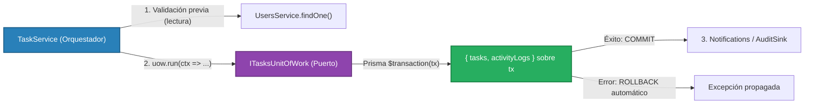

# 4.3 - Transacciones & Unit of Work

> **Objetivo del módulo:** Garantizar atomicidad ACID en operaciones multi-tabla mediante el patrón **Unit of Work** (`ITasksUnitOfWork` + `PrismaTasksUnitOfWork`), manteniendo los servicios de aplicación agnósticos de `Prisma.TransactionClient` y asegurando rollback automático ante cualquier fallo intermedio.

---

## 🧭 1. Posición en la Arquitectura & Frontera Transaccional

Una transacción abre una frontera de consistencia alrededor de múltiples repositorios. Ningún efecto secundario externo (notificaciones, HTTP, colas en memoria) debe ocurrir dentro de la transacción abierta:



- **Frontera de contexto:**
  - **Application Service:** Decide qué operaciones forman una unidad atómica (`unitOfWork.run(...)`) y ejecuta efectos secundarios externos **después** del commit.
  - **Unit of Work Port (`ITasksUnitOfWork`):** Expone un callback tipado con los repositorios participantes (`tasks`, `activityLogs`), con **zero** imports de Prisma.
  - **Unit of Work Adapter (`PrismaTasksUnitOfWork`):** Abre `prisma.$transaction(async (tx) => ...)` e instancia los repositorios concretos atados al mismo `tx`.

---

## 📜 2. El Contrato Esencial & Blueprint Idiomático

### Mapeo Mental (C# / EF Core)

| Concepto NestJS + Prisma                          | Equivalente C# / EF Core                       | Clave técnica                                                                                                 |
| :------------------------------------------------ | :--------------------------------------------- | :------------------------------------------------------------------------------------------------------------ |
| `ITasksUnitOfWork.run(work)`                      | `IUnitOfWork` + `DbContext.Database.BeginTx()` | En Prisma, el commit/rollback es automático al resolver/rechazar la `Promise` del callback `$transaction`.    |
| `Prisma.TransactionClient`                        | `IDbContextTransaction`                        | Subtipo de `PrismaClient` sin `$connect`/`$transaction`. `PrismaService` es asignable a `TransactionClient`.  |
| `new PrismaRepo(tx)` con `@Inject(PrismaService)` | `DbContext` scoped por request/UOW             | Permite inyectar `PrismaService` en DI normal y pasar `tx` manualmente dentro de `PrismaUnitOfWork` sin `as`. |

### Blueprint Canónico (Dominio Externo: `Orders` + `Inventory`)

```typescript
// 1. Puerto UoW (orders-unit-of-work.interface.ts) — Zero Prisma
export const TOKEN_ORDERS_UOW = Symbol('TOKEN_ORDERS_UOW');

export interface IOrdersUowContext {
  readonly orders: IOrdersRepository;
  readonly inventory: IInventoryRepository;
}

export interface IOrdersUnitOfWork {
  run<T>(work: (uow: IOrdersUowContext) => Promise<T>): Promise<T>;
}

// 2. Adaptador Prisma (prisma-orders-unit-of-work.ts)
@Injectable()
export class PrismaOrdersUnitOfWork implements IOrdersUnitOfWork {
  constructor(private readonly prisma: PrismaService) {}

  run<T>(work: (uow: IOrdersUowContext) => Promise<T>): Promise<T> {
    return this.prisma.$transaction((tx) =>
      work({
        orders: new PrismaOrdersRepository(tx),
        inventory: new PrismaInventoryRepository(tx),
      }),
    );
  }
}
```

---

## 💼 3. Casos de Uso del Mundo Real & Matriz de Decisión

| Enfoque en NestJS + Prisma                           | Cuándo usarlo                                                                                            | Trade-off / Por qué NO en otro caso                                                               |
| :--------------------------------------------------- | :------------------------------------------------------------------------------------------------------- | :------------------------------------------------------------------------------------------------ |
| **UoW Explícito (`uow.run(ctx => ...)`)** ✅         | Operaciones multi-repositorio con lógica intermedia (leer $\rightarrow$ validar $\rightarrow$ escribir). | Añade un puerto/adaptador por bounded context; 100% explícito, fácil de mockear y cero magia.     |
| **Batch Transaction (`prisma.$transaction([...])`)** | Lista fija de escrituras independientes sin branching ni lecturas intermedias.                           | No puedes usar el `id` generado en la query 1 dentro de la query 2 ni aplicar lógica condicional. |
| **AsyncLocalStorage (`@nestjs-cls/transactional`)**  | Sistemas enormes donde 5+ servicios anidados comparten una transacción implícita.                        | Complejidad extra, dependencia externa y acoplamiento implícito difícil de rastrear en debugging. |

---

## ⚠️ 4. Top Trampas Mortales & Antipatrones

| Antipatrón / Trampa Común                                               | Causa Técnica / Under the Hood                                                                         | Corrección Idiomática                                                                     |
| :---------------------------------------------------------------------- | :----------------------------------------------------------------------------------------------------- | :---------------------------------------------------------------------------------------- |
| **Usar `this.prismaService` en lugar de `tx` dentro de `$transaction`** | Las queries sobre `this.prismaService` usan otra conexión fuera de la transacción (no hacen rollback). | Inyectar `@Inject(PrismaService) private readonly db: Prisma.TransactionClient` en repos. |
| **Capturar errores con `try/catch` sin relanzar dentro de `run()`**     | Prisma solo ejecuta `ROLLBACK` si la promesa del callback rechaza; tragar el error provoca `COMMIT`.   | No silenciar errores dentro de `uow.run()`; relanzar o dejar propagar la excepción.       |
| **Llamar APIs externas o `notify()` dentro de la transacción**          | Mantiene bloqueos de BD abiertos durante I/O de red y dispara notificaciones de datos no commiteados.  | Ejecutar `notificationsService.notify` / `auditSink.record` **después** de `uow.run()`.   |
| **Pasar `tx?: unknown` + casts `as Prisma.TransactionClient`**          | Rompe tipado estricto y contamina cada firma de todos los repositorios con un parámetro artificial.    | Construir el `I*UnitOfWorkContext` con repositorios atados al `tx` dentro de `uow.run()`. |

---

## 🎯 5. Reto Práctico (Hands-on Challenge)

### Contexto & Objetivo de Negocio

Cada vez que se crea una tarea (`POST /api/v1/tasks`), el sistema debe persistir **atómicamente** tanto la fila en `Task` como un registro de auditoría persistente en una nueva tabla `ActivityLog` (`TASK_CREATED`), expuesta para lectura en `GET /api/v1/tasks/:id/logs`. Si cualquiera de las dos escrituras falla, SQLite debe revertir ambas automáticamente.

---

### Especificación por Archivo

#### 1. Esquema Prisma & Migración (`prisma/schema.prisma`)

- Agregar el modelo `ActivityLog`:
  - `id String @id @default(uuid())`
  - `action String`
  - `taskId String`
  - `actorId String`
  - `details String @default("")`
  - `createdAt DateTime @default(now())`
  - Relaciones:
    - `task Task @relation(fields: [taskId], references: [id], onDelete: Cascade)`
    - `actor User @relation(fields: [actorId], references: [id], onDelete: Cascade)`
- Agregar `activityLogs ActivityLog[]` en los modelos `Task` y `User`.
- Ejecutar migración: `bunx prisma migrate dev --name add-activity-log`.

#### 2. Entidad & Repositorio de `ActivityLog` (`src/modules/tasks/`)

- **`src/modules/tasks/entities/activity-log.entity.ts`**:
  - Exportar `IActivityLogEntity`:
    ```typescript
    export interface IActivityLogEntity {
      id: string;
      action: string;
      taskId: string;
      actorId: string;
      details: string;
      createdAt: Date;
    }
    ```
- **`src/modules/tasks/repositories/activity-logs-repository.interface.ts`**:
  - Exportar `TOKEN_ACTIVITY_LOGS_REPOSITORY = Symbol('TOKEN_ACTIVITY_LOGS_REPOSITORY')`.
  - Exportar `export type ICreateActivityLogData = Omit<IActivityLogEntity, 'id' | 'createdAt'>;`.
  - Exportar `IActivityLogsRepository`:
    - `create(data: ICreateActivityLogData): Promise<IActivityLogEntity>`
    - `findByTaskId(taskId: string): Promise<IActivityLogEntity[]>`
- **`src/modules/tasks/repositories/prisma-tasks.repository.ts`** (adaptación mínima):
  - Cambiar parámetro del constructor a:
    `constructor(@Inject(PrismaService) private readonly db: Prisma.TransactionClient) {}`
  - Usar `this.db.task.*` en lugar de `this.prismaService.task.*`.
- **`src/modules/tasks/repositories/prisma-activity-logs.repository.ts`**:
  - `@Injectable()` implementando `IActivityLogsRepository`.
  - Constructor: `constructor(@Inject(PrismaService) private readonly db: Prisma.TransactionClient) {}`.
  - Implementar `toEntity(row: PrismaActivityLog): IActivityLogEntity` y `toEntities(...)`.
  - `create(data)`: proyecta explícitamente `{ action, taskId, actorId, details }` sobre `this.db.activityLog.create(...)`.
  - `findByTaskId(taskId)`: consulta `this.db.activityLog.findMany({ where: { taskId }, orderBy: { createdAt: 'asc' } })` y retorna `toEntities(...)`.

#### 3. Puerto & Adaptador de Unit of Work (`src/modules/tasks/repositories/`)

- **`src/modules/tasks/repositories/tasks-unit-of-work.interface.ts`** (**Zero** imports de Prisma):
  - Exportar `TOKEN_TASKS_UNIT_OF_WORK = Symbol('TOKEN_TASKS_UNIT_OF_WORK')`.
  - Exportar:
    ```typescript
    export interface ITasksUnitOfWorkContext {
      readonly tasks: ITaskRepository;
      readonly activityLogs: IActivityLogsRepository;
    }

    export interface ITasksUnitOfWork {
      run<T>(work: (uow: ITasksUnitOfWorkContext) => Promise<T>): Promise<T>;
    }
    ```
- **`src/modules/tasks/repositories/prisma-tasks-unit-of-work.ts`**:
  - `@Injectable()` implementando `ITasksUnitOfWork`.
  - Inyecta `private readonly prismaService: PrismaService`.
  - `run<T>(work)`: llama `this.prismaService.$transaction((tx) => work({ tasks: new PrismaTasksRepository(tx), activityLogs: new PrismaActivityLogsRepository(tx) }))`.

#### 4. Integración en `TasksModule`, `TaskService` y `TasksController`

- **`src/modules/tasks/tasks.module.ts`**:
  - Registrar `{ provide: TOKEN_ACTIVITY_LOGS_REPOSITORY, useClass: PrismaActivityLogsRepository }` y `{ provide: TOKEN_TASKS_UNIT_OF_WORK, useClass: PrismaTasksUnitOfWork }`.
- **`src/modules/tasks/tasks.service.ts`**:
  - Inyectar `@Inject(TOKEN_ACTIVITY_LOGS_REPOSITORY) private readonly activityLogsRepository: IActivityLogsRepository` y `@Inject(TOKEN_TASKS_UNIT_OF_WORK) private readonly unitOfWork: ITasksUnitOfWork`.
  - Refactorizar `create(dto: CreateTaskDto)`:
    1. `await this.usersService.findOne(dto.userId);` (fuera de la transacción de escritura).
    2. Ejecutar `await this.unitOfWork.run(async ({ tasks, activityLogs }) => { ... })`:
       - Crear la tarea vía `tasks.create({ title: dto.title, description: dto.description ?? '', userId: dto.userId })`.
       - Registrar log vía `activityLogs.create({ action: 'TASK_CREATED', taskId: created.id, actorId: created.userId, details: \`Task "${created.title}" created\` })`.
       - Retornar `created`.
    3. **Después** de que `unitOfWork.run` resuelva, ejecutar `this.notificationsService.notify(...)` y `this.auditSink.record(...)`.
  - Agregar `async findLogs(taskId: string): Promise<IActivityLogEntity[]>`:
    - Validar `await this.findOne(taskId);` (lanza `NotFoundException` si no existe).
    - Retornar `await this.activityLogsRepository.findByTaskId(taskId)`.
- **`src/modules/tasks/tasks.controller.ts`**:
  - Agregar `@Get(':id/logs')` con `@Param('id', TrimPipe, ParseUUIDPipe) id: string` delegando a `this.taskService.findLogs(id)`.

#### 5. Pruebas Unitarias & Rollback Real en SQLite

- **`src/modules/tasks/tasks.service.spec.ts`**:
  - Actualizar providers con fakes para `TOKEN_TASKS_UNIT_OF_WORK` y `TOKEN_ACTIVITY_LOGS_REPOSITORY`.
  - Probar que en `create()` se crean tarea y log dentro del `unitOfWork.run`, y que si `activityLogs.create` falla, `create()` rechaza **sin** disparar `notificationsService.notify` ni `auditSink.record`.
- **`src/modules/tasks/repositories/prisma-tasks-unit-of-work.spec.ts`**:
  - Levantar `Test.createTestingModule` con `ConfigModule.forRoot({ isGlobal: true, validate: (config) => envSchema.parse(config) })`, `PrismaModule` y `PrismaTasksUnitOfWork`.
  - **Test Rollback:** Dentro de `unitOfWork.run`, crear una tarea con título único y lanzar `new Error('Simulated failure')`. Verificar que rechaza y que `prismaService.task.findMany({ where: { title } })` retorna `[]` (rollback real verificado).
  - **Test Commit:** Crear tarea + log dentro de `unitOfWork.run`, verificar que ambos persisten en SQLite, y limpiar la tarea de prueba en `finally` (`await prismaService.task.delete(...)`). Cerrar conexión en `afterAll` (`await module.close()`).

---

### Matriz de Verificación cURL & DoD

1. Confirmar **0 acoplamiento** de Prisma en `TaskService`:
   `rg -n "prisma" src/modules/tasks/tasks.service.ts` $\rightarrow$ **0 coincidencias**.
2. Ejecutar checks completos:
   `./node_modules/.bin/tsc --noEmit && ./node_modules/.bin/eslint "src/**/*.ts" "test/**/*.ts" && ./node_modules/.bin/jest` $\rightarrow$ todo en verde.
3. Verificar en runtime (`bun run start:dev`, header `x-api-key: nest-sandbox-secret-key`):
   - `POST /api/v1/tasks` con `userId: "fcea2b64-2dba-47d1-ac32-cdc13541efeb"` $\rightarrow$ `201 Created`, devuelve `id` de la tarea.
   - `GET /api/v1/tasks/<taskId>/logs` $\rightarrow$ `200 OK` con 1 registro `action: "TASK_CREATED"`.
   - `GET /api/v1/tasks/00000000-0000-0000-0000-000000000000/logs` $\rightarrow$ `404 Not Found`.

---

## 🧠 6. Checklist de Active Recall

- [ ] ¿Por qué `notificationsService.notify()` y `auditSink.record()` deben ejecutarse **después** de `unitOfWork.run()` y nunca dentro del callback?
- [ ] ¿Qué ocurre si dentro de `prisma.$transaction(async (tx) => ...)` un repositorio usa `this.prismaService` en lugar del `tx` recibido?
- [ ] ¿Por qué `PrismaTasksRepository` puede aceptar `@Inject(PrismaService) private readonly db: Prisma.TransactionClient` sin usar `any` ni `as`?
